### Escuela Colombiana de Ingeniería
### Arquitecturas de Software - ARSW

## Escalamiento en Azure con Maquinas Virtuales, Sacale Sets y Service Plans

### Dependencias
* Cree una cuenta gratuita dentro de Azure. Para hacerlo puede guiarse de esta [documentación](https://azure.microsoft.com/es-es/free/students/). Al hacerlo usted contará con $100 USD para gastar durante 12 meses.

### Parte 0 - Entendiendo el escenario de calidad

Adjunto a este laboratorio usted podrá encontrar una aplicación totalmente desarrollada que tiene como objetivo calcular el enésimo valor de la secuencia de Fibonnaci.

**Escalabilidad**
Cuando un conjunto de usuarios consulta un enésimo número (superior a 1000000) de la secuencia de Fibonacci de forma concurrente y el sistema se encuentra bajo condiciones normales de operación, todas las peticiones deben ser respondidas y el consumo de CPU del sistema no puede superar el 70%.

### Parte 1 - Escalabilidad vertical

1. Diríjase a el [Portal de Azure](https://portal.azure.com/) y a continuación cree una maquina virtual con las características básicas descritas en la imágen 1 y que corresponden a las siguientes:
    * Resource Group = SCALABILITY_LAB
    * Virtual machine name = VERTICAL-SCALABILITY
    * Image = Ubuntu Server 
    * Size = Standard B1ls
    * Username = scalability_lab
    * SSH publi key = Su llave ssh publica


2. Para conectarse a la VM use el siguiente comando, donde las `x` las debe remplazar por la IP de su propia VM (Revise la sección "Connect" de la virtual machine creada para tener una guía más detallada).

    `ssh scalability_lab@xxx.xxx.xxx.xxx`

3. Instale node, para ello siga la sección *Installing Node.js and npm using NVM* que encontrará en este [enlace](https://linuxize.com/post/how-to-install-node-js-on-ubuntu-18.04/).
4. Para instalar la aplicación adjunta al Laboratorio, suba la carpeta `FibonacciApp` a un repositorio al cual tenga acceso y ejecute estos comandos dentro de la VM:

    `git clone <your_repo>`

    `cd <your_repo>/FibonacciApp`

    `npm install`

5. Para ejecutar la aplicación puede usar el comando `npm FibinacciApp.js`, sin embargo una vez pierda la conexión ssh la aplicación dejará de funcionar. Para evitar ese compartamiento usaremos *forever*. Ejecute los siguientes comando dentro de la VM.

    ` node FibonacciApp.js`

6. Antes de verificar si el endpoint funciona, en Azure vaya a la sección de *Networking* y cree una *Inbound port rule* tal como se muestra en la imágen. Para verificar que la aplicación funciona, use un browser y user el endpoint `http://xxx.xxx.xxx.xxx:3000/fibonacci/6`. La respuesta debe ser `The answer is 8`.


7. La función que calcula en enésimo número de la secuencia de Fibonacci está muy mal construido y consume bastante CPU para obtener la respuesta. Usando la consola del Browser documente los tiempos de respuesta para dicho endpoint usando los siguintes valores:
    * 1000000
    * 1010000
    * 1020000
    * 1030000
    * 1040000
    * 1050000
    * 1060000
    * 1070000
    * 1080000
    * 1090000    

8. Dírijase ahora a Azure y verifique el consumo de CPU para la VM. (Los resultados pueden tardar 5 minutos en aparecer).


9. Ahora usaremos Postman para simular una carga concurrente a nuestro sistema. Siga estos pasos.
    * Instale newman con el comando `npm install newman -g`. Para conocer más de Newman consulte el siguiente [enlace](https://learning.getpostman.com/docs/postman/collection-runs/command-line-integration-with-newman/).
    * Diríjase hasta la ruta `FibonacciApp/postman` en una maquina diferente a la VM.
    * Para el archivo `[ARSW_LOAD-BALANCING_AZURE].postman_environment.json` cambie el valor del parámetro `VM1` para que coincida con la IP de su VM.
    * Ejecute el siguiente comando.

    ```
    newman run ARSW_LOAD-BALANCING_AZURE.postman_collection.json -e [ARSW_LOAD-BALANCING_AZURE].postman_environment.json -n 10 &
    newman run ARSW_LOAD-BALANCING_AZURE.postman_collection.json -e [ARSW_LOAD-BALANCING_AZURE].postman_environment.json -n 10
    ```

10. La cantidad de CPU consumida es bastante grande y un conjunto considerable de peticiones concurrentes pueden hacer fallar nuestro servicio. Para solucionarlo usaremos una estrategia de Escalamiento Vertical. En Azure diríjase a la sección *size* y a continuación seleccione el tamaño `B2ms`.


11. Una vez el cambio se vea reflejado, repita el paso 7, 8 y 9.
12. Evalue el escenario de calidad asociado al requerimiento no funcional de escalabilidad y concluya si usando este modelo de escalabilidad logramos cumplirlo.
13. Vuelva a dejar la VM en el tamaño inicial para evitar cobros adicionales.

**Preguntas**

1. ¿Cuántos y cuáles recursos crea Azure junto con la VM?
2. ¿Brevemente describa para qué sirve cada recurso?
3. ¿Al cerrar la conexión ssh con la VM, por qué se cae la aplicación que ejecutamos con el comando `npm FibonacciApp.js`? ¿Por qué debemos crear un *Inbound port rule* antes de acceder al servicio?
4. Adjunte tabla de tiempos e interprete por qué la función tarda tando tiempo.
5. Adjunte imágen del consumo de CPU de la VM e interprete por qué la función consume esa cantidad de CPU.
6. Adjunte la imagen del resumen de la ejecución de Postman. Interprete:
    * Tiempos de ejecución de cada petición.
    * Si hubo fallos documentelos y explique.
7. ¿Cuál es la diferencia entre los tamaños `B2ms` y `B1ls` (no solo busque especificaciones de infraestructura)?
8. ¿Aumentar el tamaño de la VM es una buena solución en este escenario?, ¿Qué pasa con la FibonacciApp cuando cambiamos el tamaño de la VM?
9. ¿Qué pasa con la infraestructura cuando cambia el tamaño de la VM? ¿Qué efectos negativos implica?
10. ¿Hubo mejora en el consumo de CPU o en los tiempos de respuesta? Si/No ¿Por qué?
11. Aumente la cantidad de ejecuciones paralelas del comando de postman a `4`. ¿El comportamiento del sistema es porcentualmente mejor?

---

## Respuestas Parte 1

### Pregunta 1 y 2 – Recursos creados con la VM

Azure crea automáticamente 5 recursos adicionales junto con la VM:

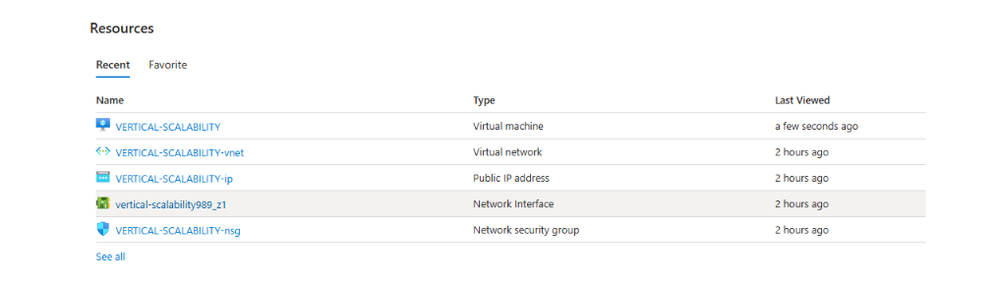

| Nombre en Azure | Tipo | Para qué sirve |
|---|---|---|
| VERTICAL-SCALABILITY | Virtual machine | La máquina virtual en sí; ejecuta el sistema operativo y la aplicación |
| vertical-scalability989_z1 | Network interface (NIC) | Conecta la VM a la red virtual y le asigna la dirección IP privada |
| VERTICAL-SCALABILITY-ip | Public IP address | IP pública que permite acceder a la VM desde internet |
| VERTICAL-SCALABILITY-nsg | Network security group | Firewall que controla el tráfico entrante y saliente mediante reglas de puerto |
| VERTICAL-SCALABILITY-vnet | Virtual network | Red privada dentro de Azure donde se conectan todos los recursos |
| (disco OS) | Managed disk | Disco de almacenamiento persistente con el sistema operativo de la VM |

### Pregunta 3 – Por qué se cae la app al cerrar SSH

Al ejecutar `node FibonacciApp.js` en la terminal SSH, el proceso pertenece a esa sesión de shell, cuando se cierra la conexión SSH el sistema operativo envía la señal SIGHUP a todos los procesos hijos de esa sesión, lo que termina el proceso Node.js. Para que la aplicación sobreviva se debe usar forever, pm2, nohup o un servicio systemd que desacople el proceso de la sesión SSH

El Inbound port rule es necesario porque el NSG bloquea todo el tráfico entrante por defecto. Sin la regla que abre el puerto 3000, el firewall descarta los paquetes antes de que lleguen a la aplicación, aunque esté corriendo correctamente dentro de la VM.

### Pregunta 4 – Tabla de tiempos (tamaño inicial)

Tiempos de respuesta medidos con la consola del navegador (DevTools → Red):

| n-ésimo Fibonacci | Tiempo de respuesta |
|---|---|
| 1.000.000 | ~6.3 s |
| 1.010.000 | ~6.3 s |
| 1.020.000 | ~6.3 s |
| 1.030.000 | ~6.4 s |
| 1.040.000 | ~6.4 s |
| 1.050.000 | ~6.4 s |
| 1.060.000 | ~6.4 s |
| 1.070.000 | ~6.4 s |
| 1.080.000 | ~6.5 s |
| 1.090.000 | ~6.5 s |

Capturas de browser (tamaño inicial):

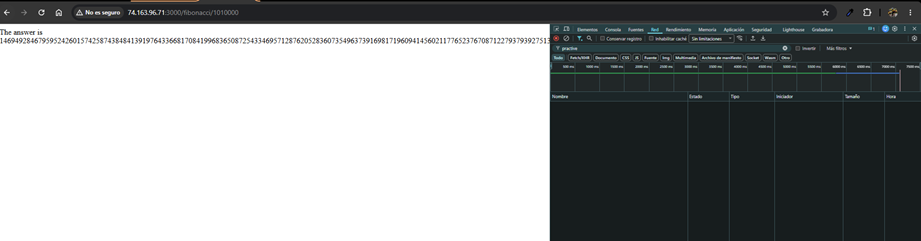
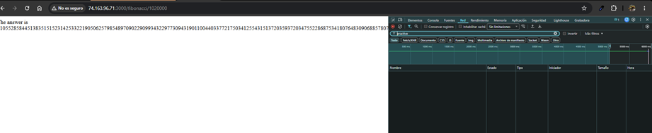
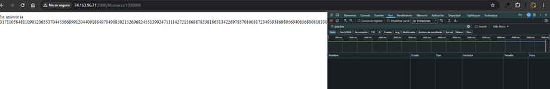
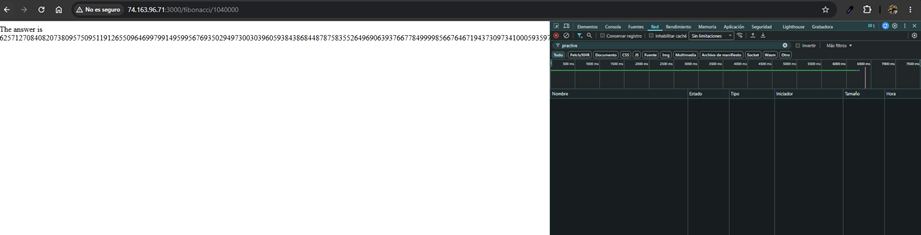
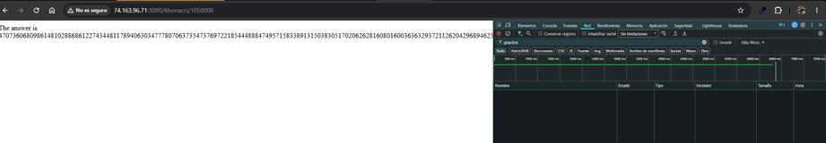
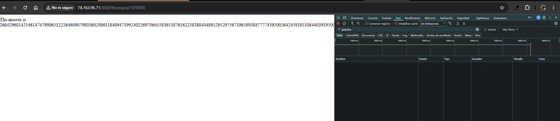
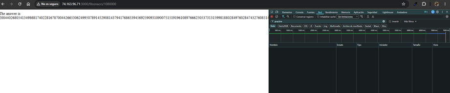
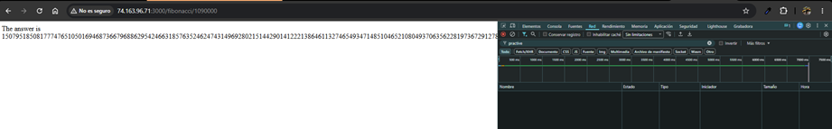

La función calcula Fibonacci sin memoización, obligándola a recorrer la secuencia completa en cada petición. Para n = 1.000.000 realiza ~1 millón de operaciones aritméticas con números de precisión arbitraria (big-integer), lo que es intensivo en CPU y explica los ~6 segundos por petición.

### Pregunta 5 – Consumo de CPU (tamaño inicial)

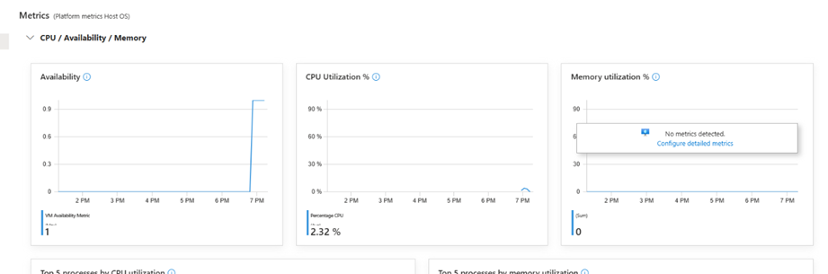

El consumo de CPU ronda el 2.32% porque la plataforma de métricas reporta el promedio del período completo. Durante la ejecución de las peticiones la CPU alcanza el 100% momentáneamente (el algoritmo es puramente computacional, sin I/O que libere el hilo). Con el tamaño inicial (D2as_v4, 2 vCPUs) una sola petición puede saturar un núcleo por completo, impidiendo que otras peticiones concurrentes sean atendidas con normalidad.

### Pregunta 6 – Resumen de ejecución Postman/Newman (tamaño inicial)

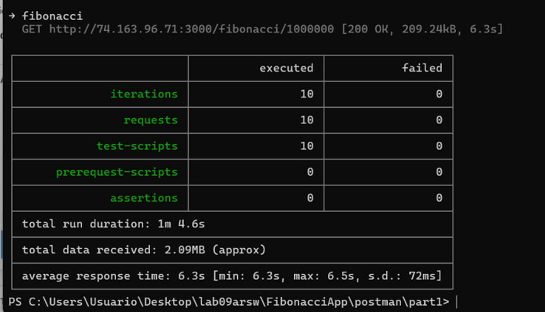

Tiempos de ejecución con las peticiones tardaron entre 6.3 s y 6.5 s (promedio 6.3 s, s.d. 72 ms). La variación mínima indica que el algoritmo es determinista y la carga de red es despreciable comparada con el tiempo de cómputo.

Fallos 0 de 10 peticiones fallaron. La VM procesó las 10 iteraciones secuenciales sin errores, aunque el tiempo total fue de 1 minuto 4.6 segundos, lo que demuestra que el sistema no puede atender concurrencia real sin degradar el servicio.

### Pregunta 7 – Diferencia entre B2ms y B1ls

| Característica | B1ls | B2ms |
|---|---|---|
| vCPUs | 1 | 2 |
| RAM | 0.5 GB | 8 GB |
| Almacenamiento temporal | 4 GB | 16 GB |
| Créditos CPU/hora | 6 | 24 |
| Costo aprox. | ~$3.80/mes | ~$60/mes |
| Modelo de bursting | Burstable (acumula créditos en reposo, los consume en picos) | Burstable con mayor baseline |

la B1ls está diseñada para cargas mínimas (CI/CD agents, proxies ligeros), mientras que la B2ms puede sostener picos de CPU por más tiempo gracias a sus 24 créditos/hora y tiene suficiente RAM para cargas de trabajo reales. Con la FibonacciApp, la B1ls agotaría sus créditos de CPU rápidamente bajo carga concurrente y el rendimiento caería al baseline (10% de 1 vCPU).

### Pregunta 8 – ¿Es buena solución escalar verticalmente?

No es la solución óptima para este escenario. Aumentar el tamaño de la VM mejora el throughput para una sola petición pesada, pero el algoritmo sin memoización seguirá consumiendo 100% de un núcleo por petición. Con 4 vCPUs podemos atender 4 peticiones simultáneas, pero el costo de la VM se dispara. Además, al cambiar el tamaño la VM se reinicia, por lo que la FibonacciApp deja de estar disponible durante el proceso de redimensionamiento (downtime).

### Pregunta 9 – Efectos del cambio de tamaño

Al redimensionar la VM, Azure detiene y reinicia la máquina virtual. Efectos negativos:
- Downtime: el servicio queda inaccesible durante el reinicio (~1-3 minutos).
- Pérdida del estado en memoria: cualquier caché o sesión en memoria se pierde.
- IP dinámica: si la IP pública no es estática, puede cambiar.
- Costo inmediato: el cambio a un tamaño mayor incrementa la factura a partir del momento del cambio, aunque la carga sea baja.

### Paso 7 repetido – Tiempos de respuesta con D4as_v4

Tiempos medidos con DevTools después del escalamiento vertical a Standard_D4as_v4 (4 vCPUs):

| n-ésimo Fibonacci | Tiempo aprox. |
|---|---|
| 1.000.000 | ~6 s |
| 1.010.000 | ~10 s |
| 1.020.000 | ~27 s |
| 1.030.000 | ~6 s |
| 1.040.000 | ~10 s |
| 1.050.000 | ~45 s |
| 1.060.000 | ~6 s |
| 1.070.000 | ~27 s |
| 1.080.000 | ~30 s |
| 1.090.000 | ~11 s |

Los tiempos más largos se explican porque el timeline de DevTools acumula todas las peticiones de la sesión de navegación. Cuando varias pestañas se abren casi simultáneamente, las peticiones se encolan en el servidor Node.js (single-threaded) y cada una espera a que termine la anterior.

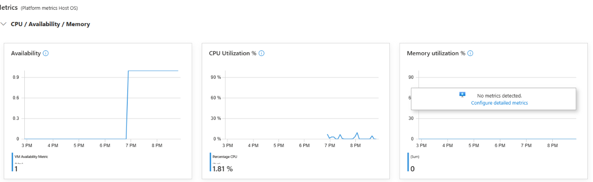
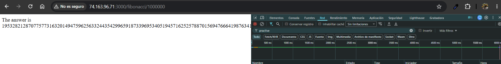
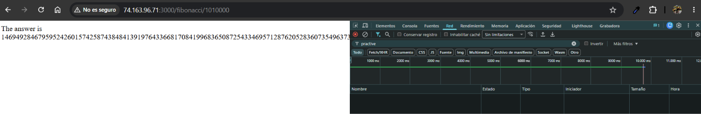
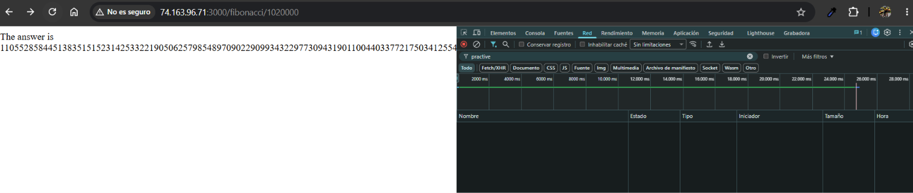
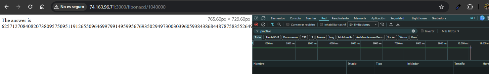
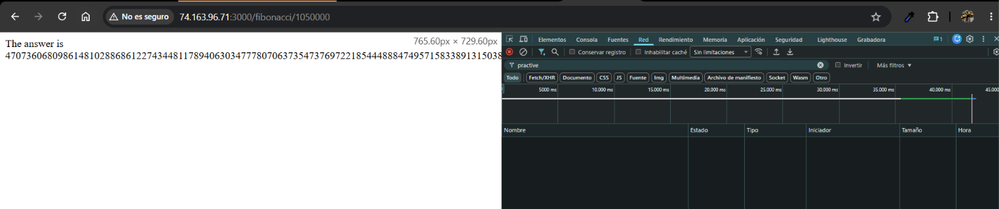
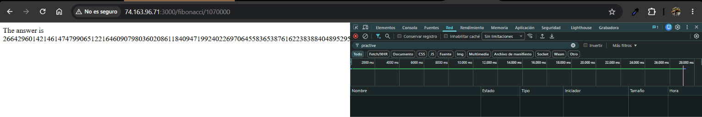
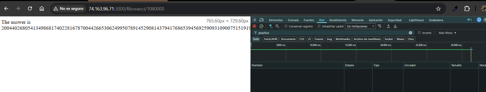

### Paso 8 repetido – CPU con D4as_v4

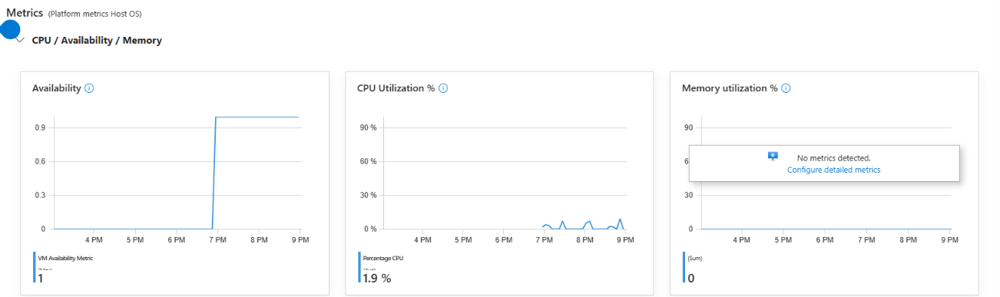

El gráfico muestra los pequeños picos de CPU alrededor de las 7–9 PM, que corresponden a los tests del browser y Newman. El promedio reportado es 1.9 %.

La métrica de Azure promedia el uso de CPU sobre todos los vCPUs disponibles en intervalos de 5 minutos. Con D4as_v4 (4 vCPUs), aunque Node.js satura un núcleo al 100% durante cada cálculo (~6 s), eso equivale solo al 25 % del total de 4 núcleos. Repartido en un intervalo de 5 minutos (donde el test duró ~1 minuto), el promedio se diluye a ~1.9 %. El comportamiento real del núcleo activo es idéntico al del tamaño inicial, confirmando que la CPU adicional no se aprovecha.

### Paso 9 repetido – Newman con D4as_v4

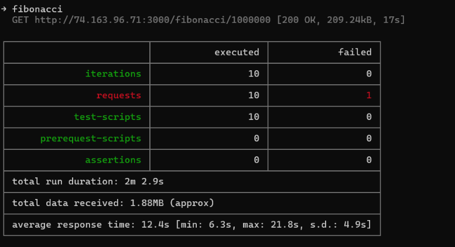

Resultados:
- Iteraciones: 10 — Fallos: 1
- Duración total: 2m 9s
- Tiempo promedio de respuesta: 12.4s [min: 6.3s, max: 21.8s, s.d.: 4.9s]

Comparación inicial vs escalado:

| Métrica | Tamaño inicial | D4as_v4 (escalado) |
|---|---|---|
| Duración total | 1m 4.6s | 2m 9s |
| Tiempo promedio | 6.3s | 12.4s |
| Mínimo | 6.3s | 6.3s |
| Máximo | 6.5s | 21.8s |
| Desviación estándar | 72ms | 4.9s |
| Fallos | 0/10 | 1/10 |

### Pregunta 10 – ¿Hubo mejora en el consumo de CPU o en los tiempos de respuesta?

No, el rendimiento empeoró bajo carga concurrente. Con el tamaño inicial la prueba de Newman dio 0 fallos y promedio de 6.3s. Con D4as_v4 bajo carga concurrente el promedio subió a 12.4s y apareció 1 fallo (ECONNRESET), con una desviación estándar de 4.9s que indica alta variabilidad. Esto ocurre porque:

1. Node.js es single-threaded: el event loop procesa una sola solicitud CPU-intensiva a la vez. Cuando múltiples clientes hacen peticiones simultáneas, se encolan y cada una espera a que termine la anterior.
2. El algoritmo no usa paralelismo: calcula la secuencia de Fibonacci de forma secuencial, por lo que tener 4 vCPUs en lugar de 2 no reduce el tiempo de cálculo por petición.
3. La CPU adicional no se aprovecha: el consumo de CPU con D4as_v4 fue de ~1.9% promedio (vs ~2.32% inicial), lo que confirma que los núcleos extra quedaron ociosos. El cuello de botella es el algoritmo, no el hardware.
4. El escalamiento vertical no es la solución correcta para este escenario. La solución adecuada sería usar memoización (cachear resultados calculados) o escalamiento horizontal con un balanceador de carga que distribuya las peticiones entre múltiples instancias del servidor.

### Pregunta 11 – 4 instancias paralelas de newman

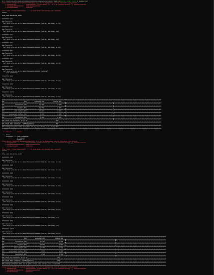

Resultados de las 4 instancias paralelas (D4as_v4):

| Instancia | Duración | Tiempo promedio | Fallos |
|---|---|---|---|
| Foreground | 3m 7.9s | 19.7s [min 6.3s, max 33.1s] | 1/10 |
| Background 1 | 2m 51.2s | 17s [min 10.7s, max 27.6s] | 1/10 |
| Background 2 | 2m 45.6s | 16.4s [min 10.6s, max 33.3s] | 0/10 |
| Background 3 | 3m 19.6s | 22.9s [min 6.3s, max 38.9s] | 2/10 |
| Total | ~3m 20s | ~19s promedio | 4/40 (10%) |

Los errores ECONNRESET ocurrieron cuando el servidor tardó demasiado y el cliente cortó la conexión antes de recibir respuesta.

Comparativa paso 9 (2 paralelas) vs paso 11 (4 paralelas):

| Métrica | 2 instancias (paso 9) | 4 instancias (paso 11) |
|---|---|---|
| Tiempo promedio | 12.4s | ~19s (+53%) |
| Duración total | 2m 9s | ~3m 20s |
| Fallos | 1/10 | 4/40 (10%) |
| Desviación estándar | 4.9s | ~7-13s |

El comportamiento con 4 instancias es peor que con 2. El tiempo promedio subió de 12.4s a ~19s y la tasa de fallos aumentó de 1/10 a 4/40. Con 4 instancias enviando 40 peticiones simultáneas al servidor Node.js (single-threaded), la cola se hace más larga: las peticiones al final esperan hasta ~38s y algunas agotaron el timeout del cliente (ECONNRESET). Esto demuestra que el escalamiento vertical no resuelve el problema de concurrencia para este escenario.

https://youtu.be/S56cuRLvTq8


### Parte 2 - Escalabilidad horizontal

#### Crear el Balanceador de Carga

Antes de continuar puede eliminar el grupo de recursos anterior para evitar gastos adicionales y realizar la actividad en un grupo de recursos totalmente limpio.

1. El Balanceador de Carga es un recurso fundamental para habilitar la escalabilidad horizontal de nuestro sistema, por eso en este paso cree un balanceador de carga dentro de Azure tal cual como se muestra en la imágen adjunta.

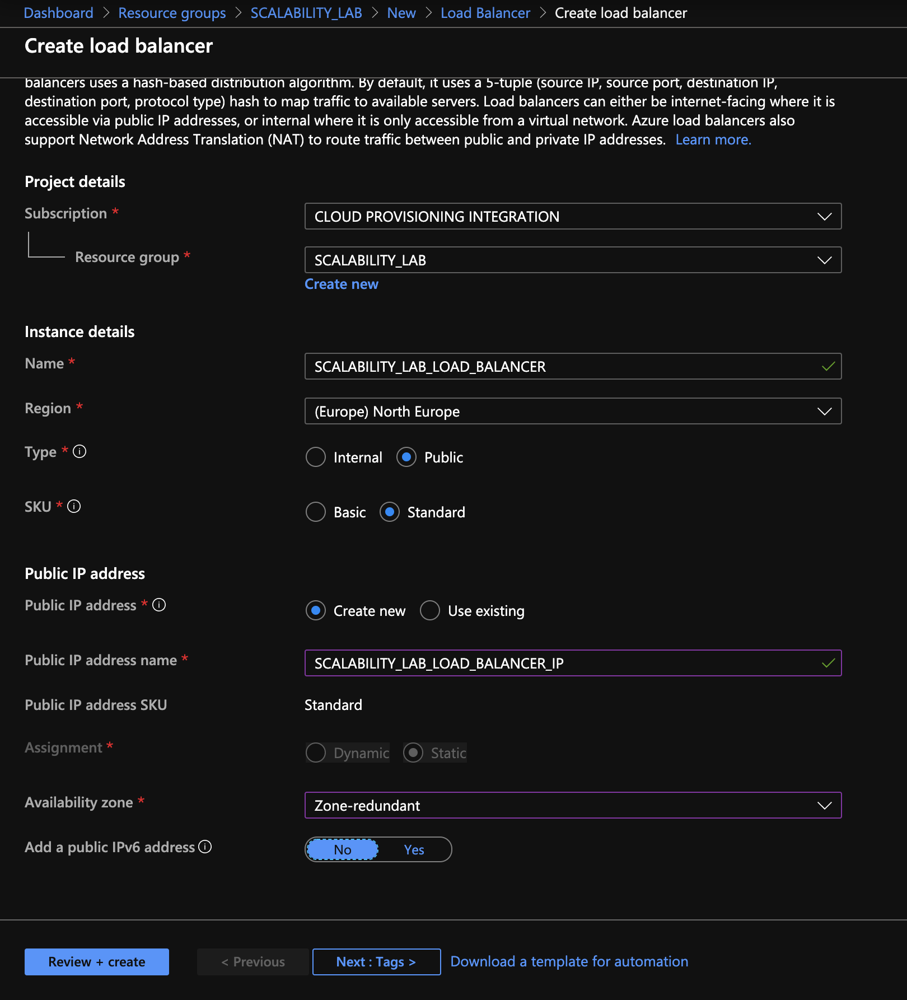

2. A continuación cree un *Backend Pool*, guiese con la siguiente imágen.


3. A continuación cree un *Health Probe*, guiese con la siguiente imágen.


4. A continuación cree un *Load Balancing Rule*, guiese con la siguiente imágen.

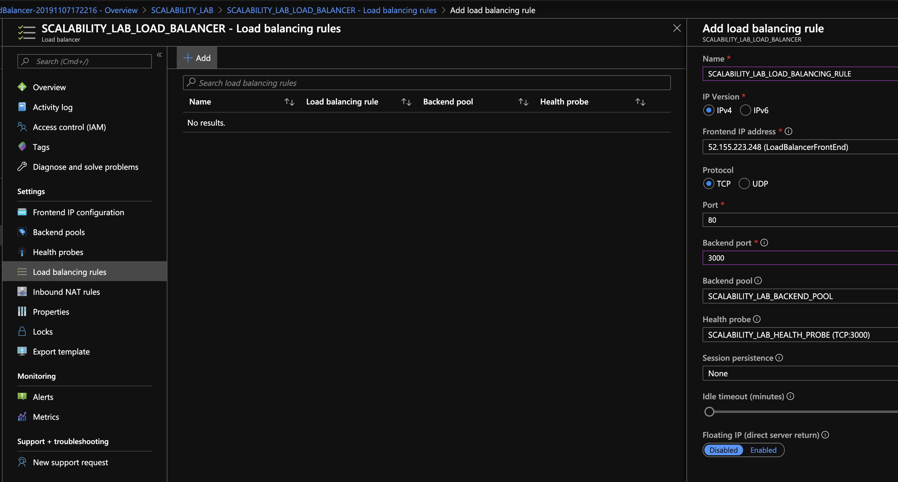

5. Cree una *Virtual Network* dentro del grupo de recursos, guiese con la siguiente imágen.


#### Crear las maquinas virtuales (Nodos)

Ahora vamos a crear 3 VMs (VM1, VM2 y VM3) con direcciones IP públicas standar en 3 diferentes zonas de disponibilidad. Después las agregaremos al balanceador de carga.

1. En la configuración básica de la VM guíese por la siguiente imágen. Es importante que se fije en la "Avaiability Zone", donde la VM1 será 1, la VM2 será 2 y la VM3 será 3.


2. En la configuración de networking, verifique que se ha seleccionado la *Virtual Network*  y la *Subnet* creadas anteriormente. Adicionalmente asigne una IP pública y no olvide habilitar la redundancia de zona.


3. Para el Network Security Group seleccione "avanzado" y realice la siguiente configuración. No olvide crear un *Inbound Rule*, en el cual habilite el tráfico por el puerto 3000. Cuando cree la VM2 y la VM3, no necesita volver a crear el *Network Security Group*, sino que puede seleccionar el anteriormente creado.


4. Ahora asignaremos esta VM a nuestro balanceador de carga, para ello siga la configuración de la siguiente imágen.


5. Finalmente debemos instalar la aplicación de Fibonacci en la VM. para ello puede ejecutar el conjunto de los siguientes comandos, cambiando el nombre de la VM por el correcto

```
git clone https://github.com/daprieto1/ARSW_LOAD-BALANCING_AZURE.git

curl -o- https://raw.githubusercontent.com/creationix/nvm/v0.34.0/install.sh | bash
source /home/vm1/.bashrc
nvm install node

cd ARSW_LOAD-BALANCING_AZURE/FibonacciApp
npm install

npm install forever -g
forever start FibonacciApp.js
```

Realice este proceso para las 3 VMs, por ahora lo haremos a mano una por una, sin embargo es importante que usted sepa que existen herramientas para aumatizar este proceso, entre ellas encontramos Azure Resource Manager, OsDisk Images, Terraform con Vagrant y Paker, Puppet, Ansible entre otras.

#### Probar el resultado final de nuestra infraestructura

1. Porsupuesto el endpoint de acceso a nuestro sistema será la IP pública del balanceador de carga, primero verifiquemos que los servicios básicos están funcionando, consuma los siguientes recursos:

```
http://52.155.223.248/
http://52.155.223.248/fibonacci/1
```

2. Realice las pruebas de carga con `newman` que se realizaron en la parte 1 y haga un informe comparativo donde contraste: tiempos de respuesta, cantidad de peticiones respondidas con éxito, costos de las 2 infraestrucruras, es decir, la que desarrollamos con balanceo de carga horizontal y la que se hizo con una maquina virtual escalada.

3. Agregue una 4 maquina virtual y realice las pruebas de newman, pero esta vez no lance 2 peticiones en paralelo, sino que incrementelo a 4. Haga un informe donde presente el comportamiento de la CPU de las 4 VM y explique porque la tasa de éxito de las peticiones aumento con este estilo de escalabilidad.

```
newman run ARSW_LOAD-BALANCING_AZURE.postman_collection.json -e [ARSW_LOAD-BALANCING_AZURE].postman_environment.json -n 10 &
newman run ARSW_LOAD-BALANCING_AZURE.postman_collection.json -e [ARSW_LOAD-BALANCING_AZURE].postman_environment.json -n 10 &
newman run ARSW_LOAD-BALANCING_AZURE.postman_collection.json -e [ARSW_LOAD-BALANCING_AZURE].postman_environment.json -n 10 &
newman run ARSW_LOAD-BALANCING_AZURE.postman_collection.json -e [ARSW_LOAD-BALANCING_AZURE].postman_environment.json -n 10
```

**Preguntas**

* ¿Cuáles son los tipos de balanceadores de carga en Azure y en qué se diferencian?, ¿Qué es SKU, qué tipos hay y en qué se diferencian?, ¿Por qué el balanceador de carga necesita una IP pública?
* ¿Cuál es el propósito del *Backend Pool*?
* ¿Cuál es el propósito del *Health Probe*?
* ¿Cuál es el propósito de la *Load Balancing Rule*? ¿Qué tipos de sesión persistente existen, por qué esto es importante y cómo puede afectar la escalabilidad del sistema?.
* ¿Qué es una *Virtual Network*? ¿Qué es una *Subnet*? ¿Para qué sirven los *address space* y *address range*?
* ¿Qué son las *Availability Zone* y por qué seleccionamos 3 diferentes zonas?. ¿Qué significa que una IP sea *zone-redundant*?
* ¿Cuál es el propósito del *Network Security Group*?
* Informe de newman 1 (Punto 2)
* Presente el Diagrama de Despliegue de la solución.

---

## Respuestas Parte 2

Las fotos, los textos de Newman y el video de esta parte están en el repositorio, no en un enlace externo.

- Pantallazos: carpeta `images/part2/`. Ahí están Hello World (`lb-root.png`), `fibonacci/1` (`lb-fibonacci-1.png`), la tabla de Newman (`newman-resumen.png`) y los mensajes de los fallos (`fallos.png`).
- Salidas completas de Newman: `images/part2/newman-1.txt` y `images/part2/newman-2.txt`.
- Video de 37 segundos: [videos/part2/evidencia-parte2.webm](videos/part2/evidencia-parte2.webm). Recorre los fallos, las dos respuestas del balanceador y la tabla de Newman.

### Tipos de balanceador, SKU e IP pública

Azure tiene varios servicios para repartir tráfico y cada uno trabaja en un nivel distinto:

| Servicio | Nivel | Para qué se usa |
|---|---|---|
| Azure Load Balancer | Capa 4 (TCP/UDP) | Reparte conexiones entre VMs de una misma región. No mira el contenido HTTP |
| Application Gateway | Capa 7 (HTTP/HTTPS) | Enruta por URL o por host, termina SSL y puede llevar WAF |
| Front Door | Capa 7, global | Reparte tráfico web entre regiones, con caché y WAF |
| Traffic Manager | DNS | Manda al cliente a una región u otra resolviendo el nombre |

En este laboratorio se usa Azure Load Balancer, porque la app solo necesita que las peticiones TCP al puerto 80 lleguen a alguna de las VMs.

El SKU es la "versión" del recurso que uno compra, y define qué funciones trae y cómo se cobra. Para el Load Balancer existían dos:

- **Basic:** gratis, sin zonas de disponibilidad, sin SLA y abierto por defecto. Microsoft lo retiró en septiembre de 2025, así que ya no se puede crear.
- **Standard:** de pago, con SLA del 99,99 %, soporta zonas de disponibilidad, IP zone-redundant y hasta 1000 instancias en el pool. Es cerrado por defecto: si no hay un NSG que permita el tráfico, no pasa nada.

También existe el SKU **Gateway**, que sirve para meter appliances de red (firewalls de terceros) en medio del tráfico, no para balancear una app.

El balanceador necesita una IP pública porque es la única puerta de entrada que ven los clientes. El navegador y Newman siempre le pegan a la misma dirección, sin saber cuántas VMs hay detrás ni cuáles están vivas. Si el balanceador fuera interno (solo IP privada), únicamente se podría usar desde dentro de la VNet.

### Backend Pool

Es la lista de máquinas que van a atender las peticiones. En este caso son las NIC de VM1, VM2 y VM3. Cuando llega una conexión nueva, el balanceador elige una de las VMs del pool que estén sanas. Para escalar horizontalmente basta con agregar otra VM al pool, sin tocar la IP que usan los clientes.

### Health Probe

Es un chequeo que el balanceador hace cada cierto tiempo a cada VM del pool para saber si está viva. Aquí se configuró por TCP al puerto 3000, cada 5 segundos, y si falla 2 veces seguidas la VM se marca como caída. Mientras esté caída no recibe conexiones nuevas; cuando vuelve a responder, entra otra vez al reparto. Sin el probe, el balanceador seguiría mandando peticiones a una VM con la app apagada y el cliente vería errores.

### Load Balancing Rule y sesión persistente

La regla es la que une todo: dice que lo que entre por la IP pública en TCP puerto 80 se mande al backend pool por el puerto 3000, usando el health probe para saber qué VMs están disponibles. Por eso las URLs de la Parte 2 no llevan `:3000`.

Tipos de persistencia de sesión:

- **None (5-tupla):** se hace un hash con IP origen, puerto origen, IP destino, puerto destino y protocolo. Cada conexión nueva puede caer en una VM distinta.
- **Client IP (2-tupla):** todas las conexiones de una misma IP de cliente van a la misma VM.
- **Client IP and protocol (3-tupla):** igual que la anterior, pero separando por protocolo.

Esto importa cuando la app guarda estado en memoria (sesiones, carritos). Si la sesión vive en una VM, el usuario tiene que volver a esa misma VM. El problema es que afecta la escalabilidad: con Client IP, todas las peticiones de Newman salen de un solo computador y caerían en una sola VM, mientras las otras dos quedan ociosas. Por eso aquí se dejó en **None**. La FibonacciApp no guarda estado, así que cualquier VM puede responder cualquier petición.

### Virtual Network, Subnet, address space y address range

La **Virtual Network** es la red privada del grupo de recursos dentro de Azure. Las VMs se hablan entre ellas por ahí y quedan aisladas de las redes de otros clientes.

La **Subnet** es un pedazo de esa red. Sirve para separar grupos de máquinas y aplicarles reglas distintas (un NSG por subnet, por ejemplo).

El **address space** es el rango total de IPs privadas de la VNet. Aquí es `10.1.0.0/16`, o sea 65.536 direcciones. El **address range** es el rango de la subnet, que tiene que estar dentro del address space. Aquí es `10.1.0.0/24`, 256 direcciones, de las cuales Azure reserva 5. De ese rango salen las IP privadas que reciben las NIC de las VMs.

### Availability Zones e IP zone-redundant

Una zona de disponibilidad es uno o varios datacenters dentro de la misma región, con su propia energía, refrigeración y red. Si una zona se cae, las otras siguen funcionando.

Se pusieron VM1, VM2 y VM3 en las zonas 1, 2 y 3 para que una falla en un datacenter no tumbe todo el servicio. Si se cae la zona 1, el health probe saca a VM1 del pool y las otras dos siguen atendiendo.

Que una IP sea **zone-redundant** significa que no está amarrada a una sola zona: Azure la sirve desde las tres. Si la IP del balanceador estuviera solo en la zona 1 y esa zona se cayera, nadie podría entrar aunque VM2 y VM3 estuvieran bien.

### Network Security Group

Es el firewall de Azure. Tiene reglas de entrada y salida que permiten o bloquean tráfico por IP, puerto y protocolo, y se puede poner sobre una NIC o sobre una subnet. Aquí el NSG `LOAD_BALANCER_NSG` deja pasar SSH (22) para administrar las VMs y el puerto 3000 para la app. Con el Load Balancer Standard es obligatorio: sin la regla del 3000, el tráfico del balanceador y del health probe se bloquea y todas las VMs aparecen caídas.

### Qué falló en el camino

Esto no salió a la primera. Abajo está cada tropiezo y por qué se cambió de plan. El pantallazo junta los mensajes tal como salieron en la consola. No es una foto del portal: esos errores salieron en PowerShell, no como ventanas. El video recorre esa misma página, las respuestas del balanceador y el resumen de Newman: [videos/part2/evidencia-parte2.webm](videos/part2/evidencia-parte2.webm).

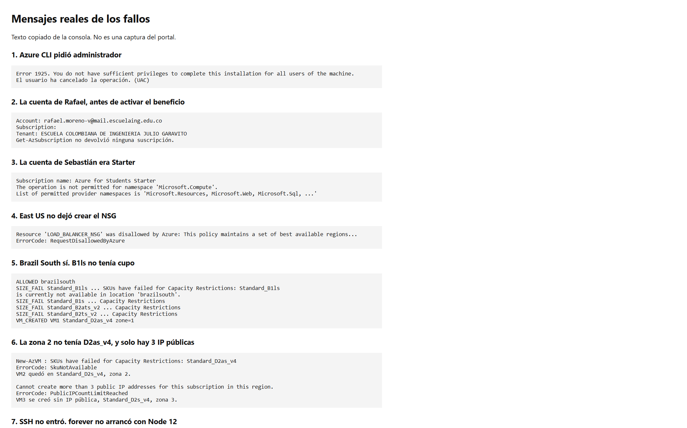

**No se pudo instalar Azure CLI.** El instalador de Windows pidió permiso de administrador (`Error 1925. You do not have sufficient privileges`) y ese aviso no se pudo aceptar. Se siguió con los módulos de Azure para PowerShell instalados solo en el usuario.

**La cuenta del correo de la Escuela, al principio, no tenía suscripción.** El inicio de sesión sí entró con `rafael.moreno-v@mail.escuelaing.edu.co`, pero `Get-AzSubscription` volvió vacío. Sin suscripción no hay máquinas ni balanceador.

**Se probó otra cuenta y era el plan equivocado.** `sebastian.castillejo@mail.escuelaing.edu.co` tiene **Azure for Students Starter**. Ese plan no deja crear máquinas virtuales ni redes. Azure respondió que `Microsoft.Compute` no está permitido. En el grupo solo había un plan de App Service. El otro directorio de esa misma cuenta pidió una verificación extra y, al entrar, tampoco tenía suscripción. Starter no se puede convertir en la oferta de 100 USD desde un comando: Microsoft pide que el estudiante active [Azure for Students](https://azure.microsoft.com/free/students/) y pase la verificación.

**Con la suscripción nueva de Rafael, East US rechazó el firewall.** El grupo se creó, pero el NSG `LOAD_BALANCER_NSG` salió con `RequestDisallowedByAzure`: la suscripción solo deja desplegar en unas regiones. Se probaron varias. **Brazil South** fue la que aceptó el NSG. Por eso el laboratorio no quedó en North Europe, que es la región de las capturas del enunciado.

**B1ls no tenía cupo en Brazil South.** El tamaño del enunciado, y también B1s, B2ats_v2 y B2ts_v2, devolvieron `Capacity Restrictions` / `SkuNotAvailable`. La primera máquina que sí se creó fue VM1, `Standard_D2as_v4`, zona 1. La misma D2as_v4 no cupo en la zona 2, así que VM2 quedó en `Standard_D2s_v4`. Esas D2 son más caras que una B1ls. No fue una elección: fue el tamaño que Azure dejó crear.

**Solo se pueden crear 3 IP públicas en esa región.** Ya estaban la del balanceador, la de VM1 y la de VM2. Al pedir la de VM3, Azure dijo `PublicIPCountLimitReached`. VM3 se creó igual, en la zona 3 y con `Standard_D2s_v4`, pero sin IP pública. El balanceador la alcanza por la IP privada. No se puede entrar por SSH a VM3 desde internet.

**SSH a VM1 no conectó.** Desde este computador el puerto 22 dio `Connection timed out` (`TcpTestSucceeded : False`), aunque el NSG tiene abierta la regla. La aplicación se instaló con `Invoke-AzVMRunCommand`, que entra por el agente de Azure y no necesita el puerto 22.

**`forever` no arrancó con el Node que trae Ubuntu.** Ubuntu 22.04 instala Node 12. El `forever` nuevo usa una sintaxis que ese Node no entiende (`SyntaxError: Unexpected token '='`). Instalar Node 20 con el paquete de NodeSource chocó con el Node de Ubuntu (`dpkg` devolvió error). Se dejó Node 20 con nvm, dentro del usuario de cada VM, y ahí `forever` sí levantó la app.

El video está en [videos/part2/evidencia-parte2.webm](videos/part2/evidencia-parte2.webm). Dura 37 segundos. Pasa por cada mensaje de error, luego por Hello World, por `fibonacci/1` y por la tabla de Newman. Los pantallazos de abajo y los archivos `newman-1.txt` y `newman-2.txt` quedan como respaldo.

### Informe de Newman (punto 2)

La infraestructura quedó en la suscripción **Azure for Students** de `rafael.moreno-v@mail.escuelaing.edu.co`, grupo `SCALABILITY_LAB`, región **Brazil South**. East US y North Europe los bloquea la política de regiones de esa suscripción. Brazil South sí dejó crear el balanceador.

El tamaño B1ls del enunciado no tenía capacidad en esa región. Quedó así:

| VM | Zona | Tamaño | IP pública |
|---|---|---|---|
| VM1 | 1 | Standard_D2as_v4 | 20.195.170.222 |
| VM2 | 2 | Standard_D2s_v4 | 191.233.29.50 |
| VM3 | 3 | Standard_D2s_v4 | no tiene: la suscripción solo permite 3 IP públicas y ya estaban el balanceador, VM1 y VM2 |

La IP del balanceador es **20.201.13.139**. Entra por el puerto 80 y reparte al 3000. La app se dejó con nvm, Node 20 y `forever`, porque el Node de Ubuntu 22.04 es la versión 12 y el `forever` actual no arranca ahí.

Comprobación en el navegador:


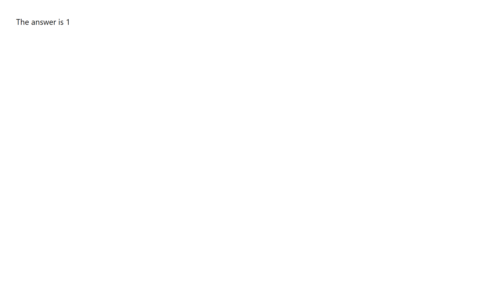

Se lanzaron dos Newman en paralelo, 10 iteraciones cada uno, contra `fibonacci/1000000`.

| Corrida | Duración | Promedio | Mínimo | Máximo | Desviación | Fallos |
|---|---|---|---|---|---|---|
| 1 | 1 min 49.9 s | 10.9 s | 10.7 s | 11.4 s | 183 ms | 0/10 |
| 2 | 1 min 21.2 s | 8.0 s | 7.8 s | 8.1 s | 79 ms | 0/10 |

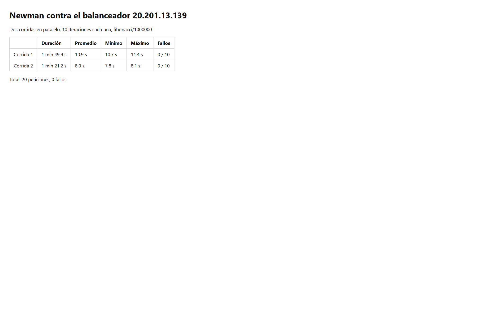

Las salidas completas están en `images/part2/newman-1.txt` y `images/part2/newman-2.txt`.

Comparado con la VM grande de la Parte 1 (D4as_v4, dos Newman en paralelo): allá el promedio fue 12.4 s, hubo 1 fallo de 10 y la duración fue 2 min 9 s. Con cuatro Newman en paralelo el promedio subió a unos 19 s y fallaron 4 de 40. Acá, con tres procesos Node detrás del balanceador, las 20 peticiones respondieron. El tiempo por petición sigue en el orden de los 8 a 11 s porque el algoritmo no cambió: cada VM sigue calculando Fibonacci en un solo núcleo. La diferencia es que ya no hay una sola cola. La desviación es de décimas de segundo, no de varios segundos.

Costo, con precios públicos aproximados de Brasil Sur (cerca de 0,15 USD por hora para una D2 de 2 vCPU y 8 GB):

- Horizontal: tres VM de ese tamaño son del orden de 0,45 USD por hora si se dejan encendidas, más el Load Balancer Standard (se cobra por la regla, cerca de 18 USD al mes) y las IP públicas.
- Vertical: una sola D4as_v4, como la de la Parte 1, sale más barata por hora que estas tres D2 en Brasil Sur.

El escalado horizontal sí cumplió mejor la parte de “responder todas las peticiones”. No salió más barato que agrandar una VM, porque no se pudo usar la B1ls del enunciado. Si las tres D2 se dejan prendidas, el crédito de 100 USD se consume en pocos días. Por eso, después de la prueba, las VM se desasignan. El balanceador sigue cobrando hasta que se borre el grupo `SCALABILITY_LAB`.

### Diagrama de despliegue

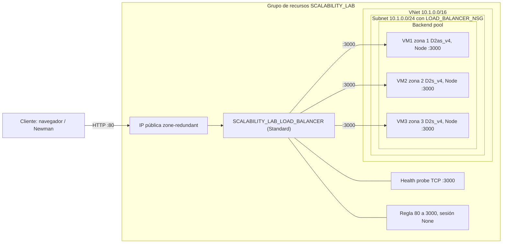


